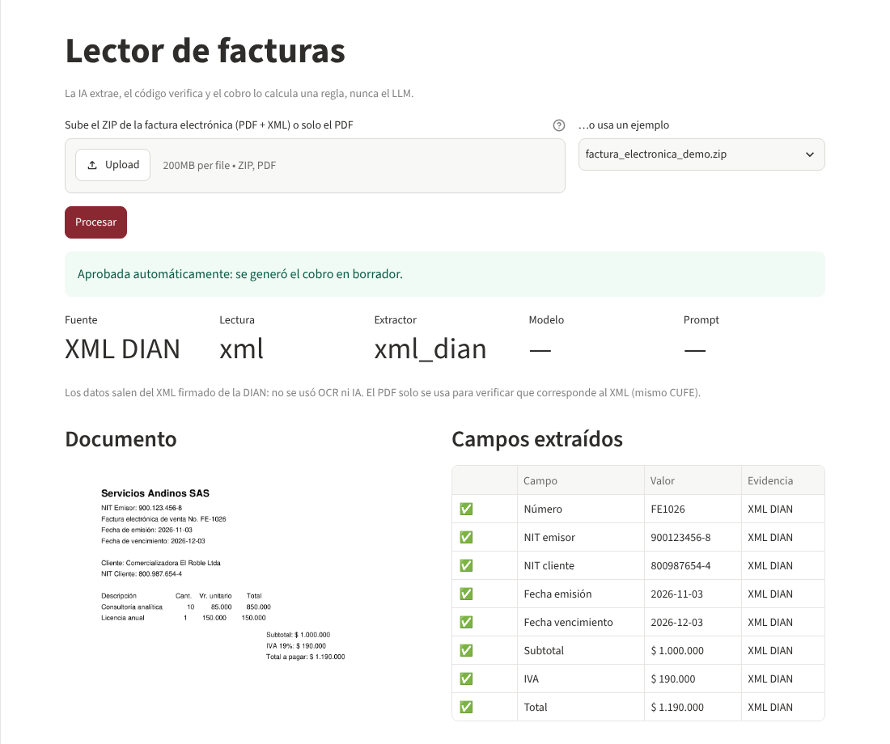
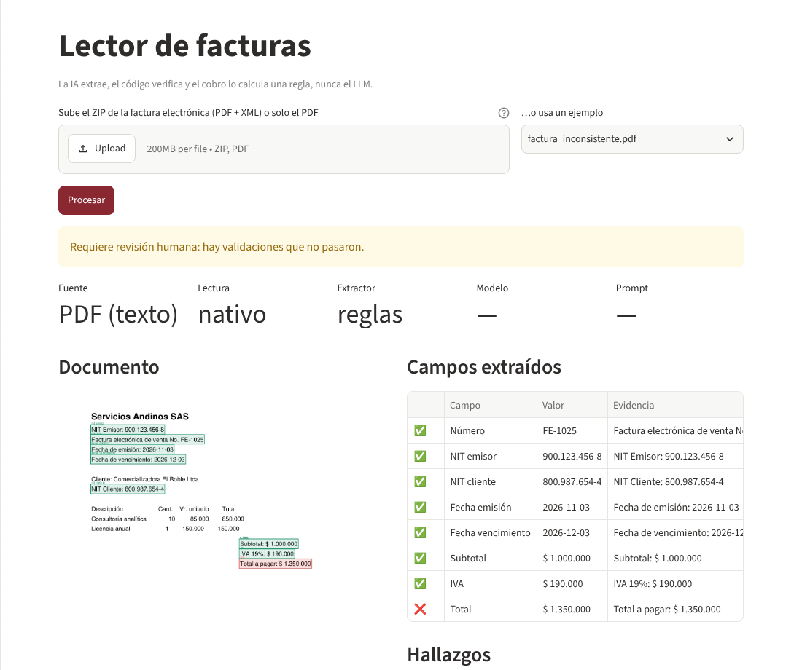
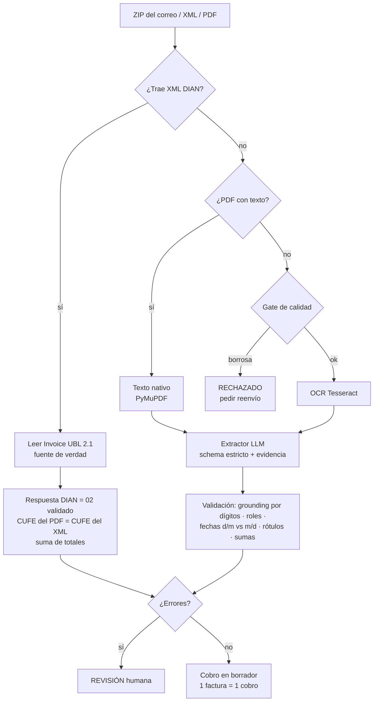

# facturas-ia

Lectura de facturas PDF (nativas o escaneadas) con IA y generación de cobros, diseñada para **no alucinar**.

> **Si la factura trae el XML de la DIAN, ese es la fuente de verdad: sin OCR ni IA.**
> Si solo hay PDF, el LLM **extrae** y está obligado a citar de dónde sacó cada valor; el código **verifica** cada valor.
> En ambos casos el cobro lo calcula una lógica determinística, **nunca el LLM**.

| Sobre 54 facturas electrónicas reales (33 emisores) | Automatización | Falsos aprobados monetarios |
|---|---|---|
| **ZIP con XML DIAN (v0.4)** | **100 %** | **0** |
| Solo PDF · gpt-4.1-mini · prompt v3 | 56 % | 0 |

| Factura electrónica (ZIP con XML DIAN): sin IA | Solo PDF: evidencia verificada en verde, error en rojo |
|---|---|
|  |  |

```
$ python -m facturas.cli samples/*.pdf

[X  ] factura_borrosa.pdf  (ocr, nitidez=1)
       - error: nitidez 1 < 30: solicitar reenvío
[OK ] factura_escaneada.pdf  (ocr, nitidez=75)
       -> cobro borrador: $1.190.000 a 800.987.654-4 antes de 2026-12-03
[REV] factura_inconsistente.pdf  (nativo)
       - error: subtotal + IVA (1190000) != total (1350000)
[OK ] factura_nativa.pdf  (nativo)
       -> cobro borrador: $1.190.000 a 800.987.654-4 antes de 2026-12-03
```

## Interfaz visual

```bash
streamlit run app.py
```

Sube un PDF o elige un ejemplo y elige el extractor (reglas, OpenAI o Claude). La interfaz muestra:

- la factura con la evidencia de cada campo resaltada: **verde** si está verificada, **rojo** si tiene error
- los campos extraídos, los hallazgos, la decisión y el cobro
- el extractor, el modelo y la versión de prompt que se usaron
- un formulario de **revisión humana**: los valores corregidos vuelven a pasar por las reglas antes de generar el cobro

## Las dos fuentes (v0.4)

Cada factura electrónica colombiana llega en un ZIP con el PDF (representación gráfica) y el **XML firmado** (`AttachedDocument` con la `Invoice` UBL 2.1 y, casi siempre, la respuesta de validación de la DIAN).

- **Camino XML** (`fuente = xml_dian`): datos tomados del XML; se exige respuesta DIAN `02` (validado) si viene, se verifica que el PDF tenga **el mismo CUFE** (que sea la representación de ese XML) y que los totales cuadren. Funciona aunque el PDF venga con clave (Claro).
- **Camino PDF** (`fuente = pdf_llm`): para documentos sin XML. Es donde está todo el trabajo de prompts y reglas de abajo.
- **Deduplicación por factura**, no por archivo: `(NIT emisor, número)` solo genera un cobro aunque llegue dos veces.
- El ZIP se lee en memoria con límites de archivos y tamaño (zip bombs), y los XML con `defusedxml`.

**Por qué importa:** en la evaluación, el PDF de Falabella rotula como «TOTAL A PAGAR» el valor *sin* IVA y el de Adidas rotula el número de factura como «Número de Caja». Ningún prompt arregla eso; el XML sí.

```bash
python -m facturas.cli correo/*.zip            # ZIP tal como llega
python -m facturas.eval eval_privado --fuente xml
```

## Escaneos y fotos: visión + OCR (v0.6)

Para PDFs sin texto (escaneados, fotos de celular), un modelo con visión lee la **imagen** y Tesseract hace una **lectura independiente**. El grounding exige que cada número que propone el modelo aparezca con los mismos dígitos en el texto del OCR: *la visión propone, el OCR confirma*. Si el OCR no logra leer un dígito, la factura va a revisión en vez de confiar en una sola lectura.

```bash
# set "escaneado" o "fotografiado" a partir de las facturas reales; el XML sigue siendo la etiqueta
python scripts/escanear_set.py eval_privado eval_foto --nivel foto
python -m facturas.eval eval_foto --llm openai --prompt v3                  # LLM sobre el texto del OCR
python -m facturas.eval eval_foto --llm openai --prompt v3 --vision openai  # visión + OCR confirma
```

## Evaluación con facturas reales

Cada factura electrónica colombiana llega por correo en un ZIP con el PDF **y el XML firmado de la DIAN**. El XML es la respuesta correcta, así que sirve para etiquetar automáticamente:

```bash
# eval_privado/f01/{factura.pdf, factura.xml}, f02/... (carpeta en .gitignore)
python -m facturas.eval eval_privado                                   # línea base sin IA
python -m facturas.eval eval_privado --llm openai --prompt v1 --salida resultados_eval_v1.json
python -m facturas.eval eval_privado --llm openai --prompt v2 --salida resultados_eval_v2.json
python -m facturas.eval eval_privado --reusar resultados_eval_v2.json   # cambiar reglas sin pagar llamadas
```

Reporta exactitud por campo, tasa de automatización, latencia, **falsos aprobados** (cobros automáticos con algún dato crítico mal) y **revisiones innecesarias** (todo estaba bien, pero una regla la frenó), con las reglas que más frenan.

### Resultados con 54 facturas (33 emisores) · gpt-4.1-mini

| | prompt v2 | **prompt v3** |
|---|---|---|
| Facturas con todos los críticos bien | 72 % | 65 % |
| Automatización | 57 % | 56 % |
| Falsos aprobados (total) | 2 | **1** |
| **Falsos aprobados monetarios** (total o NIT mal) | 1 → 0 con regla de rótulo ambiguo | **0** |
| Revisiones innecesarias | 10 | 6 |

El único falso aprobado de `v3` es de **referencia** (Adidas rotula el número de factura como «Número de Caja» y el modelo tomó otro código); el total y los NIT eran correctos. Lo que **no** se puede resolver desde el PDF —ese número, o Falabella, cuyo PDF rotula como «TOTAL A PAGAR» el valor sin IVA— queda para v0.4: leer el XML de la DIAN cuando viene.

### Primera ronda: 21 facturas, 17 emisores

| | Reglas (sin IA) | gpt-4.1-mini · prompt v1 | + reglas de rol | + prompt v2 | **+ grounding por dígitos** |
|---|---|---|---|---|---|
| Exactitud NIT cliente | 0 % | 24 % | 24 % | 95 % | **95 %** |
| Exactitud número / NIT emisor | 14 % / 52 % | 76 % / 86 % | 76 % / 86 % | 81 % / 90 % | **81 % / 100 %** |
| Exactitud total | 10 % | 100 % | 100 % | 100 % | **100 %** |
| Facturas con todos los críticos bien | 0 % | 14 % | 19 % | 62 % | **71 %** |
| Automatización | 0 % | 19 % | 5 % | 29 % | **62 %** |
| Revisiones innecesarias | – | – | – | 9 | **2** |
| **Falsos aprobados** | **0** | **4** ❌ | **0** | **0** | **0** |
| Latencia promedio | <0,1 s | 2,4 s | 2,2 s | 2,5 s | 2,8 s |

- **v1 → reglas de rol:** los 4 falsos aprobados eran valores reales en el campo equivocado (NIT del software de facturación, un celular). El grounding no los ve; las reglas de rol sí.
- **v1 → v2:** definir cada campo en el prompt (qué *no* es el número de factura, que el cliente puede tener cédula sin DV) subió el NIT del cliente de 24 % a 95 %.
- **v2 → grounding por dígitos:** 9 facturas correctas iban a revisión por **formato** (NIT con espacio, fecha `04.04.2026`, rótulo y valor unidos desde tablas, DV de cédula mal impreso). Exigir que cada número exista con los mismos dígitos —en vez de que todo el texto se parezca— las liberó sin abrir la puerta a alucinaciones (un total inventado sigue bloqueado).
- El 38 % que va a revisión es mayormente **correcto**: número de resolución tomado como número de factura, subtotal e IVA intercambiados, campos vacíos.

## Modelo y prompt engineering

| | Actual (`FACTURAS_PROMPT`, por defecto `v2`) |
|---|---|
| Modelo | OpenAI `gpt-4.1-mini` por defecto (`FACTURAS_MODELO_OPENAI`) o Claude (`FACTURAS_MODELO`). Se elegirá con la evaluación de v0.3 |
| Entrada | Solo texto (nativo u OCR) delimitado con `<factura>…</factura>`. Todavía no se envía la imagen |
| Salida | Esquema JSON estricto: Structured Outputs (`strict: true`) en OpenAI, *tool use* forzado en Claude |
| Instrucciones | Extraer solo lo literal; no calcular ni deducir; `null` si no es legible; evidencia literal obligatoria. `v2` añade la definición de cada campo (qué **no** es el número de factura, cuál NIT es cuál) a partir de errores vistos en facturas reales |
| Determinismo | `temperature=0` |
| Few-shot | No (zero-shot). Se agregará solo si la evaluación lo justifica |
| Defensa | El prompt **no** es la defensa principal: lo son el grounding, las reglas y el consenso |

Ver [ROADMAP.md](ROADMAP.md) para la salida objetivo, las métricas de éxito y los evolutivos.

## Arquitectura



## Cómo evita alucinaciones

| Capa | Qué hace | Archivo |
|---|---|---|
| Gate de calidad | Si la imagen está muy borrosa, rechaza en vez de adivinar | `texto.py` |
| Salida forzada | El LLM responde con un esquema JSON estricto (Structured Outputs de OpenAI o *tool use* de Claude), `temperature=0`, y puede devolver `null` | `extractores.py` |
| Evidencia obligatoria | Cada campo trae el fragmento literal de donde salió | `models.py` |
| Grounding | La evidencia debe existir en el texto fuente (fuzzy) **y** sus números deben aparecer exactos; además, el valor debe leerse dentro de su propia evidencia | `validacion.py` |
| Reglas fiscales | subtotal + IVA = total, tarifa IVA válida (19 / 5 / 0 %), dígito de verificación del NIT (algoritmo DIAN), fechas coherentes | `validacion.py` |
| Consenso | Un segundo extractor independiente (regex) debe coincidir en los campos críticos | `validacion.py` |
| Confianza OCR | Si la confianza promedio de Tesseract es baja, va a revisión | `pipeline.py` |
| Cobro determinístico | Solo se genera si no hay errores, y queda en estado `borrador` | `pipeline.py` |

**Dato interesante encontrado al construirlo:** la coincidencia difusa sola **no basta**. Un total alucinado `1.290.000` frente al real `1.190.000` tiene un 96 % de similitud y pasaría el filtro. Por eso los números de la evidencia se comparan de forma exacta (ver `test_detecta_total_alucinado_por_evidencia_inexistente`).

## Uso

```bash
# requisitos del sistema: tesseract + idioma español
sudo apt install tesseract-ocr tesseract-ocr-spa   # macOS: brew install tesseract tesseract-lang

pip install -e ".[dev]"
python scripts/generar_demo.py          # crea facturas ficticias en samples/
python -m facturas.cli samples/*.pdf    # extractor de reglas (sin API key)

export OPENAI_API_KEY=...                    # o ANTHROPIC_API_KEY
python -m facturas.cli samples/*.pdf --llm openai   # LLM + reglas como consenso
# modelo configurable: FACTURAS_MODELO_OPENAI / FACTURAS_MODELO

uvicorn facturas.api:app --reload       # POST /facturas con un PDF
pytest -q
```

Con Docker:

```bash
docker build -t facturas-ia .
docker run -p 8000:8000 -e OPENAI_API_KEY facturas-ia
curl -F "archivo=@samples/factura_nativa.pdf" localhost:8000/facturas
```

## Estructura

```
src/facturas/
  models.py       # Campo(valor, evidencia), FacturaExtraida, Cobro, Resultado
  texto.py        # PDF nativo vs OCR, gate de calidad, preprocesamiento
  extractores.py  # ExtractorReglas (regex), ExtractorOpenAI y ExtractorClaude
  validacion.py   # grounding, reglas fiscales, DV NIT, consenso
  dian_xml.py     # lee el XML UBL 2.1 de la DIAN (etiquetas y fuente de verdad)
  eval.py         # evaluación contra facturas reales
  pipeline.py     # orquestación y decisión automatico / revision / rechazado
  resaltado.py    # ubica la evidencia en la imagen (PDF nativo u OCR)
  api.py          # FastAPI
  cli.py
app.py                    # interfaz Streamlit
scripts/generar_demo.py   # facturas ficticias: nativa, escaneada, borrosa, inconsistente
tests/                    # incluye un LLM simulado que alucina y es atrapado
```

## Próximos pasos

Ver [ROADMAP.md](ROADMAP.md). El siguiente es **v0.3: evaluación** con facturas reales etiquetadas.

## Licencia

MIT. Las facturas de `samples/` son ficticias.
