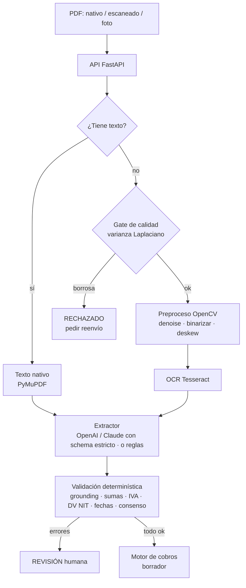

# facturas-ia

Lectura de facturas PDF (nativas o escaneadas) con IA y generación de cobros, diseñada para **no alucinar**.

> El LLM solo **extrae** y está obligado a citar de dónde sacó cada valor.
> El código **verifica** cada valor. Y el cobro lo calcula una lógica determinística, **nunca el LLM**.

```
$ python -m facturas.cli samples/*.pdf

[X  ] factura_borrosa.pdf  (ocr, nitidez=1)
       - error: nitidez 1 < 30: solicitar reenvío
[OK ] factura_escaneada.pdf  (ocr, nitidez=75)
       -> cobro borrador: $1.190.000 a 800.987.654-4 antes de 2026-12-03
[REV] factura_inconsistente.pdf  (nativo)
       - error: subtotal + IVA (1190000) != total (1350000)
[OK ] factura_nativa.pdf  (nativo)
       -> cobro borrador: $1.190.000 a 800.987.654-4 antes de 2026-12-03
```

## Arquitectura



## Cómo evita alucinaciones

| Capa | Qué hace | Archivo |
|---|---|---|
| Gate de calidad | Si la imagen está muy borrosa, rechaza en vez de adivinar | `texto.py` |
| Salida forzada | El LLM responde con un esquema JSON estricto (Structured Outputs de OpenAI o *tool use* de Claude), `temperature=0`, y puede devolver `null` | `extractores.py` |
| Evidencia obligatoria | Cada campo trae el fragmento literal de donde salió | `models.py` |
| Grounding | La evidencia debe existir en el texto fuente (fuzzy) **y** sus números deben aparecer exactos; además, el valor debe leerse dentro de su propia evidencia | `validacion.py` |
| Reglas fiscales | subtotal + IVA = total, tarifa IVA válida (19 / 5 / 0 %), dígito de verificación del NIT (algoritmo DIAN), fechas coherentes | `validacion.py` |
| Consenso | Un segundo extractor independiente (regex) debe coincidir en los campos críticos | `validacion.py` |
| Confianza OCR | Si la confianza promedio de Tesseract es baja, va a revisión | `pipeline.py` |
| Cobro determinístico | Solo se genera si no hay errores, y queda en estado `borrador` | `pipeline.py` |

**Dato interesante encontrado al construirlo:** la coincidencia difusa sola **no basta**. Un total alucinado `1.290.000` frente al real `1.190.000` tiene un 96 % de similitud y pasaría el filtro. Por eso los números de la evidencia se comparan de forma exacta (ver `test_detecta_total_alucinado_por_evidencia_inexistente`).

## Uso

```bash
# requisitos del sistema: tesseract + idioma español
sudo apt install tesseract-ocr tesseract-ocr-spa   # macOS: brew install tesseract tesseract-lang

pip install -e ".[dev]"
python scripts/generar_demo.py          # crea facturas ficticias en samples/
python -m facturas.cli samples/*.pdf    # extractor de reglas (sin API key)

export OPENAI_API_KEY=...                    # o ANTHROPIC_API_KEY
python -m facturas.cli samples/*.pdf --llm openai   # LLM + reglas como consenso
# modelo configurable: FACTURAS_MODELO_OPENAI / FACTURAS_MODELO

uvicorn facturas.api:app --reload       # POST /facturas con un PDF
pytest -q
```

Con Docker:

```bash
docker build -t facturas-ia .
docker run -p 8000:8000 -e OPENAI_API_KEY facturas-ia
curl -F "archivo=@samples/factura_nativa.pdf" localhost:8000/facturas
```

## Estructura

```
src/facturas/
  models.py       # Campo(valor, evidencia), FacturaExtraida, Cobro, Resultado
  texto.py        # PDF nativo vs OCR, gate de calidad, preprocesamiento
  extractores.py  # ExtractorReglas (regex), ExtractorOpenAI y ExtractorClaude
  validacion.py   # grounding, reglas fiscales, DV NIT, consenso
  pipeline.py     # orquestación y decisión automatico / revision / rechazado
  api.py          # FastAPI
  cli.py
scripts/generar_demo.py   # facturas ficticias: nativa, escaneada, borrosa, inconsistente
tests/                    # incluye un LLM simulado que alucina y es atrapado
```

## Próximos pasos (versión producción)

- Leer el **XML UBL 2.1** y el **QR** de la factura electrónica DIAN antes de usar OCR
- Cola (Redis/Celery) y almacenamiento de originales (S3/MinIO)
- PostgreSQL con índice único `(nit_emisor, numero)` para deduplicar
- UI de revisión humana con *bounding boxes* del OCR
- Set de evaluación etiquetado y métrica de falsos aprobados

## Licencia

MIT. Las facturas de `samples/` son ficticias.
